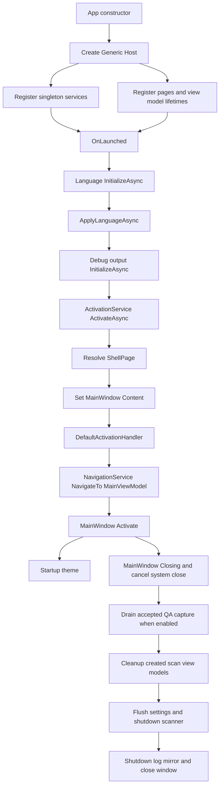

# 应用生命周期与依赖注入

## 范围与非职责 Scope and non-responsibilities

本文只覆盖 WinUI 宿主启动、Generic Host 依赖注入、激活、窗口关闭清理和 UI 线程派发。范围对应 C1 应用启动与基础设施。

本文不说明扫描业务页的内部工作流，不评估 USB 协议细节，也不把文档中的风险项写成已经修复的代码。

原生关闭、对话框和 QA 捕获并发的验证范围见[项目待办](../TODO.md)。

## 功能 Functionality

应用用 `App` 构造函数创建 .NET Generic Host，并把 WinUI 页面、ViewModel、基础服务和 Core 服务注册到同一个服务容器。启动后 `OnLaunched` 先调用语言服务的 `InitializeAsync`，再调用独立的 `ApplyLanguageAsync` 应用语言，然后初始化调试输出设置，最后调用 `IActivationService.ActivateAsync` 建立 Shell 并打开主窗口。

窗口关闭前，`MainWindow_Closing` 先同步取消系统关闭，再等待应用清理，最后允许一次真正关闭。`ShutdownAsync` 在 QA 构建先等待已接受捕获完成，随后清理实际创建的扫描 ViewModel、处理设置保存、关闭扫描器会话，最后关闭日志镜像。跨线程 UI 更新集中通过 `IUiDispatcher.TryEnqueue` 进入 `App.MainWindow.DispatcherQueue`。

## 关键入口 Key entry points

| 入口 | 源码证据 | 作用 |
| --- | --- | --- |
| `App.App` | `PRISM Utility/App.xaml.cs` | 构建 Host，注册服务，取得 `IScannerDeviceSessionManager`，订阅 `UnhandledException`。 |
| `App.GetService<T>` | `PRISM Utility/App.xaml.cs` | 从 Host 容器解析服务，记录实际创建的扫描 ViewModel，未注册时抛出 `ArgumentException`。 |
| `App.OnLaunched` | `PRISM Utility/App.xaml.cs` | 依次初始化语言、应用语言、初始化调试输出设置，调用激活服务，绑定窗口关闭事件。 |
| `App.MainWindow_Closing` | `PRISM Utility/App.xaml.cs` | 同步取消重复关闭，异步执行 `ShutdownAsync`，成功后允许最终关闭。 |
| `App.CleanupCreatedViewModelsAsync` | `PRISM Utility/App.xaml.cs` | 对已解析的 ScanViewModel 与 ScanDebugViewModel 调用 terminal cleanup，不重新解析替代实例。 |
| `ActivationService.ActivateAsync` | `PRISM Utility/Services/ActivationService.cs` | 初始化主题，创建 Shell，运行激活 handler，激活窗口，应用主题。 |
| `DefaultActivationHandler.HandleInternalAsync` | `PRISM Utility/Activation/DefaultActivationHandler.cs` | 默认导航到 `MainViewModel`。 |
| `MainWindow.MainWindow` | `PRISM Utility/MainWindow.xaml.cs` | 创建窗口、图标、标题，并订阅系统主题颜色变化。 |
| `UiDispatcherService.TryEnqueue` | `PRISM Utility/Services/UiDispatcherService.cs` | 将回调派发到主窗口 DispatcherQueue。 |

## 实现机制 Implementation mechanism

`App` 使用 `Host.CreateDefaultBuilder().UseContentRoot(AppContext.BaseDirectory).ConfigureServices(...).Build()` 建立 Host。注册有三类 lifetime。

| Lifetime | 代表注册 | 设计含义 |
| --- | --- | --- |
| Singleton | `IActivationService`、`IPageService`、`INavigationService`、`IUiDispatcher`、设置服务、USB 协调器、扫描器访问协调器、`ScanDebugViewModel` | 保留跨窗口或跨页面的应用级状态；调试页重入必须区分共享 VM 与每个 Page 的激活周期。 |
| Transient | `ShellPage`、`ShellViewModel`、各 Page、`ScanViewModel` 等其余 ViewModel、`IScanWorkflowService` 等工作流服务 | 每次解析得到新实例；已解析 Page 仍可能被 Frame 缓存。 |
| Options | `LocalSettingsOptions` | 从配置段绑定本地设置选项。 |

激活链由 `ActivationService` 管理。它先调用 `InitializeAsync` 初始化主题服务，再在 `App.MainWindow.Content == null` 时解析 `ShellPage`。Shell 放入主窗口后，`HandleActivationAsync` 先查找可处理参数的 `IActivationHandler`，再调用默认 handler。默认 handler 只有在导航 Frame 还没有内容时才导航到首页。

关闭链由 `MainWindow_Closing` 管理。处理器先设置 `args.Cancel = true`，再通过 `_windowShutdownStarted` 与 `Interlocked.Exchange` 拒绝重复进入。QA 构建在首次 await 之前关闭新捕获的入场。`ShutdownAsync` 完成后设置 `_allowWindowClose`，再调用 `MainWindow.Close()`。若关闭前的 QA drain 抛错，处理器记录错误、恢复 QA 入场并重置关闭 guard，保留窗口以允许重试。事件处理器仍是 `async void`，但异步清理调用有显式异常收尾。

UI 派发链由 `UiDispatcherService` 提供。它优先使用 `App.MainWindow.DispatcherQueue`，缺失时回退到当前线程的 `DispatcherQueue.GetForCurrentThread()`。

## 主要控制/数据流 Control and data flow

1. `App.App` 构造 Host，注册服务，初始化 XAML。
2. WinUI 调用 `App.OnLaunched`。
3. `OnLaunched` 调用 `ILanguageSelectorService.InitializeAsync()` 读取语言设置。
4. `OnLaunched` 调用 `ILanguageSelectorService.ApplyLanguageAsync()` 应用语言。
5. `OnLaunched` 调用 `IDebugOutputSettingsService.InitializeAsync()` 初始化调试输出设置。
6. `IActivationService.ActivateAsync` 初始化主题，解析 `ShellPage`，设置 `MainWindow.Content`。
7. `ActivationService.HandleActivationAsync` 运行自定义 handlers，再运行 `DefaultActivationHandler`。
8. `DefaultActivationHandler` 调用 `INavigationService.NavigateTo(AppRoute.Main, args.Arguments)`。
9. `App.MainWindow.Activate()` 显示窗口。
10. `StartupAsync` 应用主题。
11. 窗口关闭前，`MainWindow_Closing` 同步取消系统关闭和重复请求，QA 构建等待已接受捕获完成。
12. `ShutdownAsync` 禁用窗口内容，清理实际扫描 ViewModel，处理设置保存、扫描器会话及日志镜像关闭，最后允许窗口关闭。

## 依赖关系 Dependencies

| 上游 | 下游 | 证据 |
| --- | --- | --- |
| `App` | `Microsoft.Extensions.Hosting.IHost` | `PRISM Utility/App.xaml.cs` |
| `App` | `IActivationService`、`ILanguageSelectorService`、`IDebugOutputSettingsService` | `PRISM Utility/App.xaml.cs` |
| `ActivationService` | `ShellPage`、`IThemeSelectorService`、`ActivationHandler<LaunchActivatedEventArgs>` | `PRISM Utility/Services/ActivationService.cs` |
| `DefaultActivationHandler` | `INavigationService`、`MainViewModel` | `PRISM Utility/Activation/DefaultActivationHandler.cs` |
| `UiDispatcherService` | `App.MainWindow.DispatcherQueue` | `PRISM Utility/Services/UiDispatcherService.cs` |
| `MainWindow` | `TitleBarHelper`、`UISettings.ColorValuesChanged` | `PRISM Utility/MainWindow.xaml.cs` |

## Mermaid

## 状态与并发 State and concurrency

`App.MainWindow` 是静态懒加载窗口。`App.AppTitlebar` 也是静态 UI 状态，由 Shell 激活事件写入。`App.Host` 是应用级容器，Singleton 服务共享状态，Transient 页面和 ViewModel 不应依赖跨解析保留的实例字段。

关闭清理使用 `_windowShutdownStarted` 与 `Interlocked.Exchange` 防止重复进入，`_allowWindowClose` 区分最后一次真正关闭。`TrackResolvedViewModel` 使用弱引用记录 transient ScanViewModel，保留已创建的 singleton ScanDebugViewModel；terminal cleanup 与 Page Deactivate 互相区分，页面导航不会释放共享 scanner session。UI 派发使用 DispatcherQueue，但 `UiDispatcherService.TryEnqueue` 只返回是否成功入队，不等待 UI 回调执行。`MainWindow.Settings_ColorValuesChanged` 明确说明系统主题变化来自非 UI 线程，并用 `dispatcherQueue.TryEnqueue` 更新标题栏按钮颜色。

## 错误处理 Error handling

`App.GetService<T>` 对未注册服务抛出 `ArgumentException`，能快速暴露 DI 漏注册。`ActivationService` 没有捕获主题初始化、Shell 解析、handler 导航或窗口激活异常。`App_UnhandledException` 已调用 `UnhandledExceptionReporter.Report`，把异常送入 Debug mirror，并在 mirror 失败时退到 `Debug.WriteLine` 和 `Trace.WriteLine`；处理器不设置 `Handled`，因此不伪装为已恢复。关闭路径对 VM cleanup、设置保存、扫描器和镜像等待设置上限并用 `Debugger.Log` 记录异常或超时。QA drain 失败会中止当前关闭并允许重试；已接受捕获若一直不结束，当前 `StopAsync()` 仍会等待其 task，需要专门验证可终结性，不能简单超时后释放正在使用的 Page/bitmap。关闭诊断尚无统一的用户可见反馈。

## 测试覆盖 Test coverage

APP-001 的 reporter 和 source-contract 测试检查全局处理器调用 reporter、reporter 不向外抛出、mirror-first fallback、nested exception 文本保留，以及 `App_UnhandledException` 没有 `Handled` 赋值。`AppCloseLifecycleSourceContractTests` 检查实际 VM 记录与 cleanup、关闭 guard、QA drain 顺序、失败重试和有界等待。源码契约不能替代 `App.OnLaunched`、`ActivationService.ActivateAsync`、原生窗口关闭、`UiDispatcherService.TryEnqueue` 与捕获/关闭重叠的 host 验证；live WinUI controlled unhandled-event smoke 仍待验证。当前测试结果与剩余范围见[项目待办](../TODO.md)。

## 已知问题与解决方案 Known issues and solutions

| ID | 问题 | 证据 | 影响 | 短期方案 | 长期方案 |
| --- | --- | --- | --- | --- | --- |
| C1-LIFE-001 | 顶层异常报告已接入。 | `PRISM Utility/App.xaml.cs` 的 `App_UnhandledException` 调用 `UnhandledExceptionReporter.Report`，并且不设置 `Handled`。 | 未处理异常现在会尝试进入 Debug mirror、Debug 和 Trace；live WinUI event smoke 仍待运行验证。 | 验证可控 WinUI 异常事件的报告与退出行为，结果与环境限制记录在项目待办中。 | 如需用户可见 fatal error 和 handled 策略，另行设计并补 WinUI smoke。 |
| C1-LIFE-002 | 已有关闭前协调、实际 VM cleanup 和失败诊断，原生并发验收未完成。 | `PRISM Utility/App.xaml.cs` 的 `MainWindow_Closing`、`ShutdownAsync` 和 `CleanupCreatedViewModelsAsync`；`PrismVisualQaCaptureService.StopAsync` 等待已接受任务。 | QA 捕获无法终结时关闭可能持续等待；设备清理异常或超时目前主要记录日志。 | 验证捕获/卸载/关闭重叠、失败重试和重复关闭，保留正在使用的资源与现有 guard。 | 如需提取关闭协调器，先固定这些行为与明确的 teardown 契约，避免弱化现有保护。 |
| C1-DI-001 | DI 注册集中在一个方法，缺少容器验证。 | `PRISM Utility/App.xaml.cs` 的 `ConfigureServices` 同时注册 UI、Core、USB、扫描和 DNG 服务。 | 新增页面或服务时容易漏注册，问题到运行时才暴露。 | 增加轻量容器解析冒烟测试或启动自检清单。 | 按 C1 到 C6 分组注册扩展方法，并为关键入口建立契约测试。 |
| C1-UI-001 | UI 派发失败没有被调用方强制处理。 | `PRISM Utility/Services/UiDispatcherService.cs` 返回 `TryEnqueue` 的布尔值。 | 后台事件更新 UI 时，入队失败可能静默丢失状态。 | 调用方对 `false` 写入诊断日志。 | 统一 UI 调度抽象，提供可测试的失败路径和取消语义。 |

Registry links: C1-LIFE-001 -> [APP-001](issues-and-remediation.md#app-001); C1-LIFE-002 -> [APP-002](issues-and-remediation.md#app-002); C1-DI-001 -> [APP-003](issues-and-remediation.md#app-003); C1-UI-001 -> [APP-004](issues-and-remediation.md#app-004).

## 相关源码 Related source

| 路径 | 关键符号 |
| --- | --- |
| `PRISM Utility/App.xaml.cs` | `App`、`GetService<T>`、`OnLaunched`、`MainWindow_Closing`、`CleanupCreatedViewModelsAsync`、`App_UnhandledException` |
| `PRISM Utility/Services/ActivationService.cs` | `ActivationService`、`ActivateAsync`、`HandleActivationAsync` |
| `PRISM Utility/Activation/ActivationHandler.cs` | `ActivationHandler<T>`、`CanHandle`、`HandleAsync` |
| `PRISM Utility/Activation/DefaultActivationHandler.cs` | `DefaultActivationHandler`、`HandleInternalAsync` |
| `PRISM Utility/Services/UiDispatcherService.cs` | `UiDispatcherService.TryEnqueue` |
| `PRISM Utility/MainWindow.xaml.cs` | `MainWindow`、`Settings_ColorValuesChanged` |
| `PRISM Utility/Views/ShellPage.xaml.cs` | `ShellPage` 构造函数和窗口标题栏绑定 |
