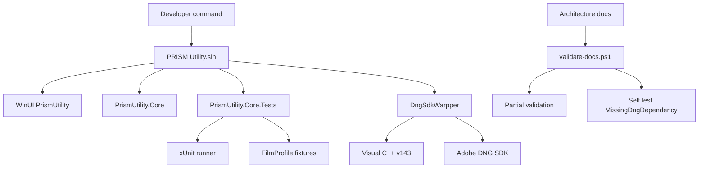

# 测试和构建

## Scope and non-responsibilities

本文覆盖 Host Software 的解决方案结构、核心测试项目、代表性测试覆盖矩阵、构建前提、文档验证器、WinUI 和原生 DNG 缺口，以及错误路径缺口。

本文记录测试和构建边界，不把缺口写成已补齐，也不声称原生 DNG 构建在没有 Adobe DNG SDK 的环境中普遍可用。

最近测试记录、历史失败分类和处理顺序统一见[项目待办](../TODO.md)。2026-10-28 当前工作区的全量托管测试为 2147/2147 通过，0 失败、0 跳过；本机 x64 native bridge 和完整 solution 构建也已通过。干净检出、CI、WinUI 原生交互、设备与实际 DNG 写入/重新读取仍需分别验证。测试应依赖入库的源码和维护中的 fixture，避免依赖本地开发记录；输出被运行中的应用占用等环境问题应与代码断言失败区分。

## Functionality

Host Software 的入口解决方案是 `Host Software/PRISM Utility.sln`。它包含 WinUI 应用 `PrismUtility`、核心库 `PrismUtility.Core`、xUnit 测试项目 `PrismUtility.Core.Tests` 和原生动态库项目 `DngSdkWarpper`。当前构建前提见[仓库 README](../../README.md)：Windows 10 1809 或更高版本、.NET 10 SDK 10.0.4xx、.NET 8 runtime、Visual Studio 2026 的 WinUI / Windows App SDK 工具或兼容 MSBuild，以及 MSVC v143 x64/x86 和 Windows SDK 10.0.19041 或更高版本。[global.json](../../global.json) 从 10.0.400 起选择最新补丁版本且不允许预览版；SDK 版本和应用的 .NET 8 目标框架是不同要求。

测试项目 `Host Software/PrismUtility.Core.Tests/PrismUtility.Core.Tests.csproj` 目标框架是 `net8.0-windows10.0.19041.0`，启用 nullable 和 preview 语言版本，引用 xUnit、Microsoft.NET.Test.Sdk、coverlet，并链接当前 source-contract tests 所需的导航、设置、本地化、PageService 和 helper 源。胶片配置 fixture 会从 Fixtures\FilmProfile 下的 JSON 文件复制到输出目录。胶片配置当前写入 schema v7，并兼容读取 v5/v6；本地校准仓库的存储 schema v2 是独立契约。

仓库根目录的[tools/build.ps1](../../tools/build.ps1)通过 vswhere 查找安装了 v143 的 Visual Studio MSBuild，检查 Adobe DNG SDK 输入，先构建 x64 原生 bridge，再恢复并构建完整解决方案。使用 `.\tools\build.ps1 -Test` 在构建后运行已有测试；`-Configuration Release` 选择发布配置。脚本的测试步骤使用 `--no-build --no-restore`，因此不能省略前面的构建。

2026-10-28 的提交前验证在当前工作区执行以下命令。完整构建退出码为 0；随后全量测试 2147/2147 通过，耗时 1 分 41 秒。相关修复的独立筛选为 767/767 通过。日志和 TRX 保存在已忽略的 `.artifacts/`，不随源码提交。

```powershell
.\tools\build.ps1
dotnet test 'PrismUtility.Core.Tests/PrismUtility.Core.Tests.csproj' --no-build --no-restore -p:PlatformTarget=x64 --blame-hang-timeout 5min --logger 'trx;LogFileName=precommit-final.trx' --logger 'console;verbosity=quiet' --results-directory '.artifacts/tests'
```

文档验证器是 `Host Software/docs/architecture/validate-docs.ps1`。Partial 模式接收指定文件，Full 模式检查交付清单。主题文档必须有 scope、functionality、key entry points、implementation、control and data flow、dependencies、state and concurrency、error handling、test coverage、known issues and solutions、related source 等章节，并且除 README 外需要 Mermaid fenced block。验证器还检查本地链接、反引号中的源路径、重复 Issue ID，以及自测 fixture 是否能拒绝损坏文档。

## Key entry points

1. `Host Software/PRISM Utility.sln` 连接托管应用、核心库、测试项目和原生 DNG 动态库。
2. `Host Software/PrismUtility.Core.Tests/PrismUtility.Core.Tests.csproj` 定义测试运行框架、包、项目引用和 fixture 复制。
3. `Host Software/docs/architecture/validate-docs.ps1` 定义文档交付清单、标准章节、Mermaid、源路径、链接和自测规则。
4. `Host Software/README.md` 定义主机构建和运行前提。
5. `Host Software/DngSdkWarpper/DngSdkWarpper.vcxproj` 定义原生 DNG bridge 的 v143、Win32、x64 和 ARM64 动态库配置。

## Implementation mechanism

测试覆盖主要集中在核心服务和源契约。测试项目没有引用 WinUI UI 自动化框架，也没有在测试中构建或加载 `DngSdkWarpper.dll`。因此测试能很好地保护扫描会话协调、USB 租约、工作流顺序、胶片配置状态、JSON schema、ScanDebug film-profile source contracts、workspace 行为和 DNG 托管验证/status seam，但不能证明 WinUI 视觉交互、真实 USB 硬件、真实扫描电机运动或原生 DNG 写入都已通过。

解决方案中的原生项目使用 Visual Studio 17 生成的 `.vcxproj`，每个 Debug 和 Release 配置都使用 `PlatformToolset` v143，平台包括 Win32、x64、ARM64。`.sln` 把 x86 映射到 Win32，把 x64 映射到 x64，把 arm64 映射到 ARM64。项目引用 Adobe DNG SDK、libjxl include 路径和 zlib 源路径，并排除 `dng_jxl`、`dng_validate`、`dng_update_meta` 等 SDK 源。没有这些 SDK 文件时，原生项目不能被当成普通可用构建路径。

文档验证器本身是 PowerShell 脚本。`Invoke-SelfTest` 会在系统临时目录下创建 `prism-doc-validator-<guid>` fixture，损坏指定规则，确认验证器拒绝损坏内容，最后删除临时目录并输出 `Self-test temp fixture cleaned: True`。这确认了 temp cleanup 行为，但它只验证文档检查器，不验证应用代码。

## Control and data flow



PageMapping: build and test command -> PRISM Utility.sln -> project configurations -> application, core, tests, native bridge.

ServiceCoverage: ScanFilmProfileWorkspace

## Dependencies

1. Host app build requires the .NET 10 SDK selected by `global.json`, .NET 8 runtime, Windows 10 1809 or later, and Visual Studio 2026 with WinUI / Windows App SDK tooling or compatible command-line MSBuild. The repository build script also requires MSVC v143 and the Windows SDK; see the current [README](../../README.md).
2. Core tests require `Microsoft.NET.Test.Sdk` 17.11.1, xUnit 2.9.2, xUnit runner 2.8.2 and coverlet.collector 6.0.2 from the existing test project.
3. Native DNG build requires Visual C++ v143 and local Adobe DNG SDK files referenced by `DngSdkWarpper.vcxproj`.
4. The architecture docs validator requires PowerShell and direct filesystem access to source paths listed in backticks.
5. Real scanner validation requires PRISM hardware and USB devices described elsewhere in the repository, so it is outside the current unit test matrix.

## State and concurrency

The tests use in-memory doubles for repositories, sessions, coordinators and services. Several tests intentionally create concurrent calls, such as workspace initialization and scanner lifecycle arbitration, but the suite does not run a full WinUI app or live USB stack.

`ScanDebugCalibrationStatusTests` initializes `PRISM.Utility.UseResourceFallbacks` itself. Its standalone filtered run therefore does not depend on another test class first enabling the fallback, and avoids repeated failed ResourceLoader creation in the test host.

The document validator creates temporary fixtures only for self-test mode and deletes them in finally. Partial validation of existing docs is read-only.

## Error handling

The test suite has strong coverage for managed error states in services: cancellation, failed repository writes, malformed JSON, future schema, invalid enum values, invalid acquisition settings, scanner access denial, USB lease conflicts and lifecycle disconnect handling. It has weaker coverage for DNG native error statuses, WinUI runtime failures, actual hardware timeouts and hung build processes.

Build validation should report missing Visual C++ v143, Windows SDK or Adobe DNG SDK inputs as dependency failures. Run managed tests, Core/app builds and the native bridge build as separate checks with bounded execution time. A successful dependency probe is not a successful native build, and a successful build is not native runtime verification. Record timeout and cleanup results for build processes started by validation; do not terminate unrelated application processes. Native ABI, DNG writing and JXL stub runtime need dedicated smoke probes.

## Test coverage

Representative files in the current test project are listed below.

The current full run includes the restored configuration save/check/handoff behavior and source contracts, the schema 2 filesystem migration harness, and new negative coverage retaining an unmapped selected IR role while blocking a complete save. White-channel persistence also verifies that v5/v6 migration preserves legacy automatic Steady lighting, while a modern schema 7 file's explicit Off setting stays Off. These managed checks preserve the original serialization fixture and do not establish native file-picker or physical illumination behavior.

| Area | Representative files | What they cover | Main gaps |
| --- | --- | --- | --- |
| Film profile ScanDebug workspace | `Host Software/PrismUtility.Core.Tests/FilmProfileSourceContractTests.cs`, `Host Software/PrismUtility.Core.Tests/FilmProfileLocalizationAccessibilityContractTests.cs`, `Host Software/PrismUtility.Core.Tests/ScanDebugFilmProfileOrchestrationSourceTests.cs`, `Host Software/PrismUtility.Core.Tests/ScanFilmProfileWorkspaceTests.cs` | ScanDebug JSON New/Open/Validate/Save command surface, staged review Apply/Discard, source contracts, localization/accessibility contracts and workspace transitions. | Real WinUI rendering, keyboard focus, file picker UI and visual QA. |
| Film profile services | `Host Software/PrismUtility.Core.Tests/ScanFilmProfileDocumentServiceTests.cs`, `Host Software/PrismUtility.Core.Tests/ScanFilmProfileWorkspaceTests.cs`, `Host Software/PrismUtility.Core.Tests/ScanCalibrationProfileRepositoryTests.cs` | Schema v7 parsing/writing, v5/v6 compatibility, malformed and future documents, workspace dirty state, import staging, repository migration and write failures. | Hardware produced calibration values and full UI file picker flow. |
| Calibration status and candidate review | `Host Software/PrismUtility.Core.Tests/ScanDebugCalibrationStatusTests.cs`, `Host Software/PrismUtility.Core.Tests/Cal001AutoCalibrationAndFocusTests.cs` | Pending candidate review, Accept / Accept and Save / Restore / Cancel, warm-up-settled before/after metrics and CAL-001 fake service algorithm coverage. | Physical scanner, illumination, restoration on device, calibration quality and focus motion require device validation. |
| Scan workflow and sessions | `Host Software/PrismUtility.Core.Tests/ScanWorkflowServiceTests.cs`, `Host Software/PrismUtility.Core.Tests/ScanDebugCalibrationStatusTests.cs`, `Host Software/PrismUtility.Core.Tests/ScanWorkflowSessionCoordinatorTests.cs`, `Host Software/PrismUtility.Core.Tests/ScannerLifecycleIntegrationRegressionTests.cs` | Delta row snapshots, FIFO delivery, callback isolation, preview generation lifecycle, contiguous/stale/gap/legacy preview merges, illumination off before returns, motor transport disabled, progress metadata, warm-up ownership and cleanup. | Live scanner timing, physical warm-up behavior and hung motion behavior on real firmware. |
| USB access | `Host Software/PrismUtility.Core.Tests/UsbBulkDuplexSessionTests.cs`, `Host Software/PrismUtility.Core.Tests/UsbUsageCoordinatorLeaseTests.cs`, `Host Software/PrismUtility.Core.Tests/UsbDeviceCatalogTests.cs`, `Host Software/PrismUtility.Core.Tests/Usb001ContractTests.cs` | Bulk duplex behavior, lease arbitration, catalog filtering, retired `StopBulkIn` API and `StartBulkInAsync` fake cancellation lifecycle. | Real driver stack, cable removal, endpoint stalls and hardware cancellation timing. |
| Image processing | `Host Software/PrismUtility.Core.Tests/ScanCompositeImageProcessorTests.cs`, `Host Software/PrismUtility.Core.Tests/ScanChannelAlignmentServiceTests.cs`, `Host Software/PrismUtility.Core.Tests/ScanImageDecoderImg001Tests.cs` | Composite pixels, partial rows, alignment service behavior, zero-row waterfall rejection and valid output preservation. | DNG packing service, native writer output validation and UI bitmap rendering. |
| DNG-001 managed seam | `Host Software/PrismUtility.Core.Tests/DngWriterServiceValidationTests.cs`, `Host Software/PrismUtility.Core.Tests/DngWriterServiceNativeStatusTests.cs`, `Host Software/PrismUtility.Core.Tests/DngWriterServiceNativeAbiLayoutTests.cs` | Managed request validation, DllNotFound/BadImageFormat/EntryPointNotFound missing export mapping, exact native ABI message mapping, status 1 to 5/unknown mapping and x64 ABI header contract. | Native C++ sizeof/parity, real DNG writing, JPEG XL stub runtime and WinUI export interaction require separate verification. |
| Utility math and text | `Host Software/PrismUtility.Core.Tests/ScanTimingMathTests.cs`, `Host Software/PrismUtility.Core.Tests/InvariantNumericTextTests.cs`, `Host Software/PrismUtility.Core.Tests/ScanMotorDistanceTextTests.cs`, `Host Software/PrismUtility.Core.Tests/ScanChannelRoleHelperTests.cs`, `Host Software/PrismUtility.Core.Tests/Scan007UnitContractsTests.cs` | Timing conversion, invariant numeric formatting, checked UI microsecond conversion, nanosecond protocol/model contracts, motor distance text and role counting. | Localized UI integration beyond source contracts. |

Durable project quality gate matrix:

| Gate | Purpose | Pass criterion | Known limitation |
| --- | --- | --- | --- |
| Full validator | Protect the 18 document deliverables, required sections, source paths, local links, issue links, Mermaid fences and duplicate issue IDs. | `validate-docs.ps1 -Mode Full` reports all deliverables valid and cleans Mermaid render temp output. | It validates documentation structure and references, not production code behavior. |
| Partial validator | Check targeted document edits without weakening the Full deliverable contract. | `validate-docs.ps1 -Mode Partial -Files ...` reports the named documents valid. | It covers only the supplied files, so it is not a substitute for Full validation. |
| xUnit managed tests | Protect managed Core services, scanner lifecycle contracts, film profile behavior, image processing and utility math. | `PrismUtility.Core.Tests` completes with all expected tests passing. | The suite uses fakes and source contracts, so it does not prove WinUI rendering, real USB hardware or native DNG writing. |
| Calibration regression | Protect calibration algorithms and candidate review state. | Calibration and status tests satisfy the documented state transitions, cancellation, cleanup and failure contracts. | Managed fakes do not validate physical illumination, restoration, motion or calibration quality; CAL-002 remains a separate algorithm decision. |
| DNG-001 managed seam | Protect request validation and status mapping without requiring Adobe DNG SDK. | DNG validation, status and ABI layout tests satisfy the managed API contract. | The x64 layout tests describe the expected header contract, not native C++ sizeof. Native packed row-stride minimum and blackLevelPlaneCount equality remain separate risks. |
| Core compile | Protect the shared library API surface and managed implementation. | `PRISM Utility.Core.csproj` builds without errors. | It does not compile the WinUI app package or native bridge. |
| Solution and native build probe | Check application tooling and native bridge readiness. | `tools/build.ps1` finds required dependencies and completes native and solution builds with successful exit codes. | Dependency readiness does not prove compilation; compilation does not prove native bridge or JXL runtime behavior. |
| UI and hardware validation | Cover behavior outside the managed test harness. | Manual or automated smoke exercises the WinUI surface and supported scanner hardware. | Live unhandled-event handling, USB timing, warm-up behavior and physical cleanup require the corresponding application or device environment. |
| Temp cleanup | Keep validator self-tests from leaving repository or system temp residue. | Self-test output reports `Self-test temp fixture cleaned: True`. | This only proves validator fixture cleanup, not cleanup in application services. |

TEST-002 boundary: source contracts cover typed routes, Page host contracts, VM-001 lifecycle, UI-006 Scan workspace ownership, UI-007 ScanDebug geometry ownership, VM-002 public surface, film-profile contracts and SET-005 settings saving. These tests pass in the current full run but do not drive the native WinUI surface. Historical failures, completed repairs and remaining coverage are tracked in the [project backlog](../TODO.md).

Unautomated end-to-end UI states remain: NavigationCache lifecycle safety, ScanDebug Canvas pointer and ROI interactions, file picker cancel and success paths, Settings save-error InfoBar render and accessibility, language switch state retention, window-close teardown and hardware-driven pages.

## Known issues and solutions

Issue-ID: TEST-BUILD-001

Managed `DngWriterService` tests cover request validation, status mapping, missing exports and the x64 header layout. Native ABI, DNG write/read smoke and JPEG XL stub runtime remain unverified by these tests. Source inspection of intentional `SupportsJXL=false` stubs does not establish runtime behavior. Maintain native smoke probes and artifacts separately, including packed row-stride minimum and blackLevelPlaneCount equality checks; see DNG-001 and the [project backlog](../TODO.md).

Issue-ID: TEST-BUILD-002

WinUI coverage is mostly source-contract and view model based. A maintained suite is still missing for NavigationCache lifecycle, ScanDebug Canvas pointer and ROI interactions, file picker cancel and success, Settings save-error InfoBar rendering and accessibility, language-switch state retention, window-close teardown and hardware-driven pages. Current regression results are tracked in the [project backlog](../TODO.md). Introducing UI automation requires an explicit choice of tooling and maintenance scope.

Issue-ID: TEST-BUILD-003

The local x64 native bridge and full solution build passed on 2026-10-28. A clean checkout and CI build remain unverified and depend on Visual Studio, Windows App SDK and Adobe DNG SDK installation. CI should split managed tests, app packaging, and native bridge build into separate jobs so a missing SDK is reported as a dependency failure, not as a generic hung or broken build. Compilation does not establish native ABI, actual DNG write/read or JPEG XL stub runtime behavior.

Registry links: TEST-BUILD-001 -> [DNG-001](issues-and-remediation.md#dng-001); TEST-BUILD-002 -> [TEST-002](issues-and-remediation.md#test-002); TEST-BUILD-003 -> [TEST-001](issues-and-remediation.md#test-001).

## Related source

`Host Software/PRISM Utility.sln`

`Host Software/README.md`

`Host Software/PrismUtility.Core.Tests/PrismUtility.Core.Tests.csproj`

`Host Software/docs/architecture/validate-docs.ps1`

`Host Software/DngSdkWarpper/DngSdkWarpper.vcxproj`

`Host Software/PrismUtility.Core.Tests/FilmProfileSourceContractTests.cs`

`Host Software/PrismUtility.Core.Tests/FilmProfileLocalizationAccessibilityContractTests.cs`

`Host Software/PrismUtility.Core.Tests/ScanDebugFilmProfileOrchestrationSourceTests.cs`

`Host Software/PrismUtility.Core.Tests/ScanFilmProfileDocumentServiceTests.cs`

`Host Software/PrismUtility.Core.Tests/ScanFilmProfileWorkspaceTests.cs`

`Host Software/PrismUtility.Core.Tests/ScanCalibrationProfileRepositoryTests.cs`

`Host Software/PrismUtility.Core.Tests/ScanWorkflowServiceTests.cs`

`Host Software/PrismUtility.Core.Tests/UsbBulkDuplexSessionTests.cs`
