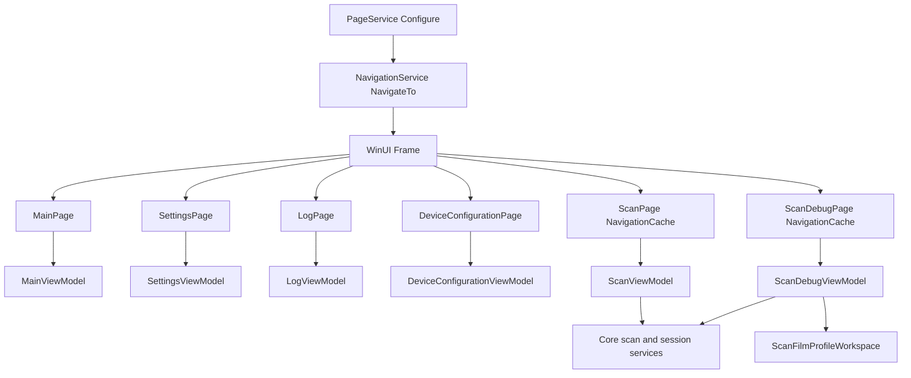

# UI 与 MVVM 结构

## Scope and non-responsibilities

本文覆盖 PRISM Utility WinUI 层的 Page 到 ViewModel 绑定方式、页面 code-behind 边界、导航缓存、事件订阅、UI dispatch 和重复状态风险。范围只到 UI 编排和 ViewModel 状态投影。底层 USB、扫描协议、电机、照明、图像解码和 DNG 写入由 Core 服务承担，本文不会把这些硬件实现写成 ViewModel 的职责。

当前验证结果、未完成项与职责提取条件见[项目待办](../TODO.md)。

PageMapping: MainPage -> MainViewModel
PageMapping: SettingsPage -> SettingsViewModel
PageMapping: LogPage -> LogViewModel
PageMapping: DeviceConfigurationPage -> DeviceConfigurationViewModel
PageMapping: ScanPage -> ScanViewModel
PageMapping: ScanDebugPage -> ScanDebugViewModel

## Functionality

UI 层采用直接页面构造注入模式。每个 Page 在构造函数中通过 `App.GetService<TViewModel>()` 解析自己的 ViewModel，再调用 `InitializeComponent()`。注册关系集中在 `Host Software/PRISM Utility/Services/PageService.cs`，六条 `AppRoute` registration 定义 typed route 到 Page 类型的映射，并通过 `IPageViewModelHost<TViewModel>` 固定 Page 到 ViewModel 的编译期配对。

六个 Page 到 ViewModel 的职责如下。

| Page | ViewModel | XAML 绑定职责 | code-behind 边界 |
| --- | --- | --- | --- |
| `Host Software/PRISM Utility/Views/MainPage.xaml` | `MainViewModel` | 首页卡片按钮绑定 `NavigateToScanCommand`、`NavigateToScanDebugCommand`、`NavigateToSettingsCommand` | `MainPage.xaml.cs` 只解析 ViewModel 和初始化组件 |
| `Host Software/PRISM Utility/Views/SettingsPage.xaml` | `SettingsViewModel` | 主题 RadioButton 使用 `SwitchThemeCommand` 驱动并以 OneWay `IsChecked` 显示当前主题；语言、日志镜像、Bulk IN 传输和彩色管理设置可使用 `x:Bind` 双向值绑定 | `SettingsPage.xaml.cs` 只解析 ViewModel 和初始化组件 |
| `Host Software/PRISM Utility/Views/LogPage.xaml` | `LogViewModel` | `Entries`、`StatusText`、`EmptyStateVisibility` 和 `ClearCommand` 驱动日志列表 | `LogPage.xaml.cs` 在 Unloaded 调用 `ViewModel.Dispose()` |
| `Host Software/PRISM Utility/Views/DeviceConfigurationPage.xaml` | `DeviceConfigurationViewModel` | 电机机械参数、通道角色和 DNG 几何设置双向绑定 | `DeviceConfigurationPage.xaml.cs` 只解析 ViewModel 和初始化组件 |
| `Host Software/PRISM Utility/Views/ScanPage.xaml` | `ScanViewModel` | 扫描工作流卡片、状态提示、预览、输出和命令绑定 | `ScanPage.xaml.cs` 负责 Loaded/Unloaded 生命周期、PropertyChanged 订阅和滚动到阻塞卡片 |
| `Host Software/PRISM Utility/Views/ScanDebugPage.xaml` | `ScanDebugViewModel` | 扫描调试、校准、ROI、预览画布、DNG 导出和胶片档案 workspace；包括 New、Open JSON、Validate、Save JSON、staged review Apply/Discard、current/staged validation 和 dirty-state 投影 | `ScanDebugPage.xaml.cs` 负责 Canvas 绘制、缩放、ROI 鼠标交互、discard confirmation 与其他对话框，以及 ViewModel 事件订阅 |

## Key entry points

关键入口按调用顺序排列。

| 入口 | 作用 |
| --- | --- |
| `Host Software/PRISM Utility/Services/PageService.cs` | 六个 `AppRoute` registration 建立 typed route 到 Page 类型的唯一映射，约束 exact Page/ViewModel host pair，并校验 enum 闭集 |
| `Host Software/PRISM Utility/Services/NavigationService.cs` | `NavigateTo(AppRoute, ...)` 获取 Page 类型，Frame 导航成功后调用旧 ViewModel 的 `OnNavigatedFrom()` 和新 ViewModel 的 `OnNavigatedTo()` |
| `Host Software/PRISM Utility/Views/ScanPage.xaml` | `NavigationCacheMode="Enabled"` 让扫描页实例可被 Frame 缓存 |
| `Host Software/PRISM Utility/Views/ScanDebugPage.xaml` | `NavigationCacheMode="Enabled"` 让调试页实例可被 Frame 缓存 |
| `Host Software/PRISM Utility/Contracts/Services/IUiDispatcher.cs` | ViewModel 从服务或后台回调回到 UI 线程的最小接口 |
| `Host Software/PRISM Utility/Services/UiDispatcherService.cs` | 使用 `App.MainWindow.DispatcherQueue` 或当前线程 DispatcherQueue 执行 UI 更新 |

## Implementation mechanism

页面绑定主要使用 `x:Bind ViewModel.Property` 和 `x:Bind ViewModel.Command`。这让 XAML 编译期知道 ViewModel 类型。Page 持有 ViewModel 不是反射约定，而是 `IPageViewModelHost<TViewModel>` 契约入口；非泛型 `IPageViewModelHost` 提供导航层直接读取 object ViewModel 的统一面。简单页面不处理业务事件，复杂页面只处理 WinUI 控件层无法自然放入 ViewModel 的行为。

`PageService.Configure<TPage, TViewModel>` 要求 `TPage : Page, IPageViewModelHost<TViewModel>`。因为 `IPageViewModelHost<TViewModel>` 是不变泛型，缺少 host、Page host 的 ViewModel 类型和 registration 的 ViewModel 类型不一致、或用 derived host 代替 base host 都不能通过 compile harness。当前六个真实页面 `MainPage`、`LogPage`、`ScanPage`、`ScanDebugPage`、`SettingsPage` 和 `DeviceConfigurationPage` 均声明精确 host pair。

Main、Settings、DeviceConfiguration 和 Log 的 code-behind 很薄。Main、Settings、DeviceConfiguration 只解析 ViewModel。Log 额外在卸载时释放 `LogViewModel`，因为 `LogViewModel` 订阅了 `IDebugOutputMirrorService.EntryMirrored`。

Scan 和 ScanDebug 的 code-behind 是 UI 编排边界，不是硬件边界。`ScanPage.xaml.cs` 订阅 `ScanViewModel.PropertyChanged`，当 `FirstBlockingCardId` 改变时把对应卡片滚入视图。`ScanDebugPage.xaml.cs` 处理 Win2D Canvas bitmap、预览缩放、ROI overlay、TextBox 同步和 ContentDialog，底层扫描执行仍由 `ScanDebugViewModel` 调用 Core 服务完成。

扫描页的准备项与运行进度共用顶部状态区，进度环和进度条读取同一组实际轮次进度。完成、取消与文件输出反馈由 `ScanViewModel.Presentation.cs` 保留，常规设备刷新不会覆盖结果；新扫描清理上次反馈与输出位置。加载配置后记录本页参数基准，修改摘要与恢复命令只影响本次扫描，运行或导出期间禁止恢复。执行摘要以两行常显于左栏顶部，显示行数、轮数、起始方向和每行距离，完整明细通过详情浮层查看。左栏优先排列配置选择和常用扫描参数，配置详情与色彩管理随后提供；左右栏宽只随窗口宽度调整。预览空态与图像都填充结果区的剩余高度，空态沿用胶片配置页的实色背景。预览的启用和对齐选项收纳于原生浮出菜单，结果区独立滚动以容纳长输出路径和反馈。

ScanDebug 的胶片档案 workspace 现在留在同一 Page 和 ViewModel 中。`ScanDebugViewModel` 通过 `IScanFilmProfileWorkspace` 投影 current draft、baseline、dirty state 和 staged import；通过 `IScanFilmProfileFileCoordinator` 执行 JSON Open/Save；通过 `IScanFilmProfileDocumentService` 和 workspace validation 分离 current profile 与 staged import 的校验摘要。Open JSON 只暂存导入并显示 `StagedFilmProfileImportReview`，Apply 才替换当前 workspace，Discard 清除 staged import。New 会在有未保存更改时请求 discard confirmation dialog。

## Control and data flow

导航使用 typed `AppRoute`，不再使用 ViewModel `FullName` route 字符串。`MainViewModel.NavigateToScan()`、`NavigateToScanDebug()` 和 `NavigateToSettings()` 调用 `INavigationService.NavigateTo(AppRoute.Scan)`、`AppRoute.ScanDebug` 和 `AppRoute.Settings`。`PageService.GetPageType()` 根据 route 返回 Page 类型。Frame 导航成功后，`NavigationService.OnNavigated()` 通过 `Frame.GetPageViewModel()` 从 `IPageViewModelHost` 找到新页面的 ViewModel，并在其实现 `INavigationAware` 时调用 `OnNavigatedTo()`，再发布 `Navigated`。旧页面的 `OnNavigatedFrom()` 只在 `Frame.Navigate` 或 `GoBack` 成功后执行。

普通数据流是 XAML 直接读写 ViewModel。Settings 属性变化和 restore/default 命令把保存操作交给 owner-scoped `SettingsSaveCoordinator`, 并通过 `IUiDispatcher.TryEnqueue()` 把 latest result 的 rollback、per-scope error 和既有 persistence InfoBar 更新切回 UI 线程。DeviceConfiguration 仍在属性变化回调中保存设置。Scan 和 ScanDebug 使用 ViewModel 属性驱动按钮、InfoBar、ProgressBar 和预览，同时通过 `IUiDispatcher.TryEnqueue()` 接收会话、传输或扫描进度回调。Log 通过 `IDebugOutputMirrorService.EntryMirrored` 接收日志镜像，再由 dispatcher 把 `ObservableCollection` 修改切回 UI 线程。

ScanDebug 的 Page 事件形成额外 UI 循环。`PreviewCanvasControl_Draw` 从 `ViewModel.ObservationFrame` 创建或复用 `CanvasBitmap`，因此可显示当前帧、冻结快照或 A 基线。`RefreshPreviewLayout()` 设置 CanvasControl、PreviewCanvas、RoiCanvas 和 AxisCanvas 尺寸，安排初始 fit zoom，并在没有 frame 时清空 overlay、axis、cursor text 和 bitmap。zoom、pan 和 ROI pointer handlers 仍在 code-behind 内更新 `ScrollViewer` offset、捕获 pointer、计算 image x/y、更新 cursor sample text，并把 ROI 或 column sample range mutation 调回 ViewModel。`DrawAxes()` 和 `DrawRoiOverlays()` 仍负责 axis tick、ROI rectangle、label 和 sample overlay 呈现。`OnViewModelPropertyChanged` 通过带 activation epoch 检查的 `EnqueueForCurrentActivation()` 更新画布和编辑器。ContentDialog 仍由 Page 展示，`ScanDebugDialogLifetime` 登记具体 Page/epoch/实例并在卸载时退休；逻辑 completion 与真实 `Hide()` 分别收尾。当前校准照明 TextBox/ComboBox mirror sync 也留在 code-behind。ROI selection、overlay visibility、ROI input TextBox 和 apply/reset command 仍在 XAML/ViewModel 绑定面。这些代码只管理控件和呈现状态，不发送硬件命令。

## Dependencies

| 层 | 依赖 |
| --- | --- |
| Page | `Microsoft.UI.Xaml.Controls.Page`、XAML 控件、`App.GetService<T>()`、对应 ViewModel |
| ViewModel | CommunityToolkit MVVM 的 `ObservableRecipient`、`ObservableProperty`、`RelayCommand`，以及应用服务和 Core 合同 |
| UI dispatch | `IUiDispatcher`、`UiDispatcherService`、WinUI `DispatcherQueue` |
| 导航 | `INavigationService`、`IPageService`、`PageService`、`NavigationService`、`IPageViewModelHost<TViewModel>`、`FrameExtensions.GetPageViewModel()` |
| 扫描与档案 | `IScannerDeviceSessionManager`、`IScanWorkflowService`、`IScanFilmProfileWorkspace` 等 Core 服务 |

## State and concurrency

`NavigationCacheMode="Enabled"` 只出现在 `ScanPage.xaml` 和 `ScanDebugPage.xaml`。这两个页面的 Page 实例可能跨导航保留，因此它们必须在 Loaded 时订阅运行时事件，在 Unloaded 时解绑，避免缓存页面继续接收后台事件。ScanPage 用 `_isLoaded` guard 配对 Page 级 `PropertyChanged` 订阅；ScanViewModel 构造函数和 Loaded 的 `Activate()` 共用 session 订阅 guard。ScanDebugPage 用 activation epoch 和 Page owner 保护激活、卸载与迟到回调，卸载先退休本周期对话框，再按 owner 停用绑定并释放呈现资源。非缓存页面仍应解绑，因为服务和 ViewModel 生命周期可能长于视觉树。

UI 线程边界有两种。ViewModel 侧通过 `IUiDispatcher.TryEnqueue()` 处理服务回调，例如 `ScanViewModel.OnSessionSnapshotChanged()` 和 `LogViewModel.OnEntryMirrored()`。Page 侧直接使用 `DispatcherQueue.TryEnqueue()`，例如 `ScanDebugPage.OnViewModelPropertyChanged()` 更新 Canvas 和 ROI overlay。

当前状态重复主要集中在两个区域。第一，Scan 和 ScanDebug 都持有扫描参数、色彩管理、DNG 导出模式、预览状态和会话状态的 UI 副本，源分别是设置服务、session manager、workflow result 和用户输入。第二，ScanDebug 胶片档案 workspace 同时投影 `FilmProfileName`、acquisition/recipe/channel 输入、current validation、staged validation、dirty state 和 `_lastProjectedFilmProfileDraft`/`_lastProjectedStagedFilmProfileImport`，依靠 `_isSynchronizingFilmProfileWorkspace` 防止外部 snapshot 投影和用户编辑互相回写。

体量风险仍存在。ScanViewModel 和 ScanDebugViewModel 集中较多编排与投影职责，已有 partial 文件没有自动改变状态和资源 owner。这里的结论是可维护性风险，不是说这些 ViewModel 直接实现硬件协议。硬件协议仍在 Core 服务中。

## Error handling

多数简单绑定页没有 Page 级异常处理。Settings 保存不再是未观察 fire-and-forget: language、theme、debug、transfer 和 color 五个 family, 包括 restore/default, 都由 `SettingsSaveCoordinator` 返回 result；latest failure 先写 Debug mirror diagnostic, 再经 UI dispatcher rollback visible state 并显示既有 Settings persistence InfoBar。DeviceConfiguration 的保存路径仍使用 fire-and-forget `_ = Save...Async()`，异常路径需要依赖服务层或全局异常处理记录。Log 的 `Dispose()` 防重复释放，避免多次 Unloaded 重复解绑。

ScanDebugPage 的 dialog 事件处理器捕获异常并写入 `TaskCompletionSource`，避免 ViewModel 等待的交互任务永久悬挂。胶片档案 New 的 discard confirmation、校准 prompt 和 notice dialog 都在 ScanDebugPage code-behind 边界完成，ViewModel 通过 operation message、severity 和 validation summary 暴露用户可见状态。

## Test coverage

当前生命周期源码与 managed 行为覆盖包括 `AppCloseLifecycleSourceContractTests`、`ScanDebugPageReentryUi006SourceContractTests`、`ScanDebugDialogLifetimeTests`，以及 `ScanDebugCalibrationStatusTests` 中的 Page reentry、terminal cleanup、迟到确认和 RAW 发布用例。原生 dialog、Canvas/pointer 和捕获并发需独立运行验证。

`Host Software/docs/architecture/validate-docs.ps1` 检查必需章节、源码路径、链接和 Mermaid。导航测试覆盖 typed route、精确 Page/ViewModel host 配对、编译期拒绝错误配对、生产 metadata、直接 host retrieval 与 lifecycle callback 顺序。Settings 测试覆盖 coordinator owner、per-scope errors、五类设置、恢复默认、commit/rollback、UI dispatcher、有界收尾和 InfoBar source contract。VM-001/UI-006 测试覆盖 Loaded guard、对称订阅、app-owned cleanup、Page owner/epoch 和迟到回调；UI-007 测试覆盖 Canvas/ROI/display/pointer/overlay/dialog 所有权、Core clamp 边界和 code-behind 不直接访问硬件服务的约束。胶片档案测试覆盖 ScanDebug orchestration、本地化/可访问性 source contracts 和 workspace 行为。当前结果见[项目待办](../TODO.md)。

VM-002 source/projection 测试覆盖 `ScanDebugViewModel` 的 public binding surface、commands、events、preview、ROI、calibration、film profile projection、session/workflow orchestration 和 lifecycle calls。这些职责仍集中于同一 ViewModel；测试不代表职责拆分已完成，也不能证明 WinUI runtime safety。

TEST-002 的原生交互验证仍待补齐。source contracts 和 managed fakes 不能证明 NavigationCache leave/return、ScanDebug pointer/ROI、Canvas rendering、file picker cancel/success、Settings save-error InfoBar 可访问性、语言切换状态保留、窗口关闭或硬件页面安全。当前断言失败的分类与处理顺序见[项目待办](../TODO.md)。

## Known issues and solutions

Issue-ID: UI-MVVM-001
问题：Scan 和 ScanDebug 都启用 NavigationCache，且各自持有较多 UI 状态副本。ScanViewModel 当前仍拥有扫描执行和 stop/load/export 命令、RGB/raw 预览投影、color management 与 profile settings 投影、`_lastResult`、`_loadedSnapshot` 和 selected acquisition settings 等 cached state。Loaded/Unloaded guard、App 对实际 VM 的 terminal cleanup、ScanDebug 的 Page owner/epoch 与 dialog 退休均已接入。剩余提取门槛是活动任务导航、快速重入、原生 dialog/Canvas/pointer 和捕获与关闭并发的运行证据。短期方案是补齐[项目待办](../TODO.md)中的验证，并保持已有 owner；职责拆分必须限定对象和可审查边界。

Issue-ID: UI-MVVM-002
问题：`ScanDebugPage.xaml.cs` 同时承担 Canvas bitmap、display sizing、zoom/pan pointer、ROI drag pointer、cursor sample text、axis and ROI overlay drawing、ContentDialog completion 和校准照明 TextBox/ComboBox sync。ROI selection、overlay visibility、ROI input TextBox 和 apply/reset command 由 XAML/ViewModel 绑定面承担。已有 Loaded guard、实际 VM cleanup、Page owner/epoch 与 dialog 退休机制，但 geometry/display 所有权仍在 Page。短期保持 code-behind 只做 UI 编排，并完成 [TODO T04](../TODO.md#开发与验证) 的原生 host 验证；之后按 [TODO T19](../TODO.md#开发与验证) 选择单一职责提取范围，补齐行为与资源生命周期验证。

Issue-ID: UI-MVVM-003
事实: SET-005 已关闭 Settings 保存缺口。SettingsViewModel 现在用 owner-scoped `SettingsSaveCoordinator` 管理 language、theme、debug、transfer 和 color 五个 family 的属性保存与 restore/default 命令；latest failure 会先 mirror diagnostic, 再通过 UI dispatcher rollback visible state 并显示既有 Settings persistence InfoBar；页面和 app teardown 都有 bounded flush/cancel。DeviceConfiguration 和 ScanDebug film-profile workspace 仍有双向文本输入到 typed state 的重复状态。短期方案是继续使用各设置 loading guard 和 ScanDebug 的 `_isSynchronizingFilmProfileWorkspace` 防止回写循环。长期方案是提取共享的输入投影和校验模型，减少 TextBox 字符串状态和 typed settings 的漂移。

Issue-ID: UI-MVVM-004
问题：`ScanDebugViewModel` 当前仍是同一 owner 下的扫描调试编排类。绑定面包括 start/stop/export commands、acquisition rows、motor、preview、waterfall、DNG mode、calibration channel/actions、autofocus、illumination、motion、ROI edit/reset/apply commands，以及 film-profile New/Open JSON/Validate/Save JSON/Apply staged/Discard staged workspace commands。事件面仍是 `CalibrationPromptRequested`、`NoticeRequested`、`CalibrationSectionRequested` 和 film-profile discard confirmation request。ScanDebugPage Loaded 通过 `AttachRuntimeBindingsForPage()` 激活，Unloaded 经 `DeactivateForPageAsync()` 停用；ViewModel 内部继续拥有 session target、transfer setting 和 film profile workspace 订阅。`CleanupAsync()` 先设置 terminal 状态、取消交互等待及 VM 自有任务、解绑 coordinator snapshot，再调用 Deactivate。协作者仍包括 scan debug session coordinator、workflow service、calibration/autofocus services、channel image service、parameter service、film profile workspace、file coordinator、document service和 UI dispatcher。partial 文件和局部 helper 不代表 preview、ROI、calibration 等 ownership 已转移。source-contract tests 不证明 runtime safety；后续拆分仍应以具体切片证据为前提。

Registry links: UI-MVVM-001 -> [UI-006](issues-and-remediation.md#ui-006); UI-MVVM-002 -> [UI-007](issues-and-remediation.md#ui-007); UI-MVVM-003 -> [SET-005](issues-and-remediation.md#set-005); UI-MVVM-004 -> [VM-002](issues-and-remediation.md#vm-002).

## Related source

`Host Software/PRISM Utility/Services/PageService.cs`

`Host Software/PRISM Utility/Services/NavigationService.cs`

`Host Software/PRISM Utility/Contracts/ViewModels/IPageViewModelHost.cs`

`Host Software/PRISM Utility/Helpers/FrameExtensions.cs`

`Host Software/PRISM Utility/Contracts/Navigation/NavigationLifecycleDispatcher.cs`

`Host Software/PRISM Utility/Contracts/Services/IUiDispatcher.cs`

`Host Software/PRISM Utility/Services/UiDispatcherService.cs`

`Host Software/PRISM Utility/Views/MainPage.xaml`

`Host Software/PRISM Utility/Views/MainPage.xaml.cs`

`Host Software/PRISM Utility/ViewModels/MainViewModel.cs`

`Host Software/PRISM Utility/Views/SettingsPage.xaml`

`Host Software/PRISM Utility/Views/SettingsPage.xaml.cs`

`Host Software/PRISM Utility/ViewModels/SettingsViewModel.cs`

`Host Software/PRISM Utility/Views/LogPage.xaml`

`Host Software/PRISM Utility/Views/LogPage.xaml.cs`

`Host Software/PRISM Utility/ViewModels/LogViewModel.cs`

`Host Software/PRISM Utility/Views/DeviceConfigurationPage.xaml`

`Host Software/PRISM Utility/Views/DeviceConfigurationPage.xaml.cs`

`Host Software/PRISM Utility/ViewModels/DeviceConfigurationViewModel.cs`

`Host Software/PRISM Utility/Views/ScanPage.xaml`

`Host Software/PRISM Utility/Views/ScanPage.xaml.cs`

`Host Software/PRISM Utility/ViewModels/ScanViewModel.cs`

`Host Software/PRISM Utility/Views/ScanDebugPage.xaml`

`Host Software/PRISM Utility/Views/ScanDebugPage.xaml.cs`

`Host Software/PRISM Utility/ViewModels/ScanDebugViewModel.cs`
