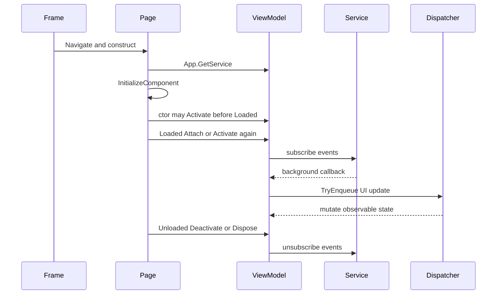

# ViewModel 生命周期

## Scope and non-responsibilities

本文说明六个主要 ViewModel 的创建、Attach、Deactivate、Cleanup 和 Dispose 路径，以及事件订阅、UI dispatch、NavigationCache 对生命周期的影响。本文不描述底层扫描硬件如何工作，也不把协议、USB 会话或 DNG 写入实现归入 ViewModel 生命周期。ViewModel 的职责是持有 UI 状态、命令和服务编排边界。

当前验证结果与职责拆分条件见[项目待办](../TODO.md)。源码和 managed 测试不能替代 WinUI 原生场景验证。

PageMapping: MainPage -> MainViewModel
PageMapping: SettingsPage -> SettingsViewModel
PageMapping: LogPage -> LogViewModel
PageMapping: DeviceConfigurationPage -> DeviceConfigurationViewModel
PageMapping: ScanPage -> ScanViewModel
PageMapping: ScanDebugPage -> ScanDebugViewModel

## Functionality

ViewModel 生命周期由 Page 构造、Frame 导航和 Page Loaded/Unloaded 共同决定；应用关闭路径先清理已创建的 ScanViewModel 和 ScanDebugViewModel，再处理设置保存及 scanner session manager。`App.GetService<T>()` 记录实际解析的扫描 ViewModel，关闭时不重新解析替代实例。所有六个页面都在 code-behind 构造函数内解析 ViewModel。轻量 ViewModel 依靠依赖注入容器和页面生命周期自然释放。订阅外部事件或持有后台回调的 ViewModel 显式提供 Deactivate、Cleanup 或 Dispose。

MainViewModel 只发起导航命令。SettingsViewModel 和 DeviceConfigurationViewModel 在构造函数启动异步加载，并用 loading flag 避免加载期间保存回写。LogViewModel 订阅日志镜像服务，必须 Dispose。ScanViewModel 构造函数内先调用 `Activate()`，ScanPage Loaded 会再次调用 `Activate()`；`Activate()` 内的 `_areSessionEventsSubscribed` guard 防止重复订阅 session 事件，Page 的 `_isLoaded` guard 防止重复订阅 `PropertyChanged`。ScanPage Unloaded 调用 `Deactivate()`，应用关闭通过 `CleanupCreatedViewModelsAsync()` 调用已创建实例的 `CleanupAsync()`。ScanDebugViewModel 在 ScanDebugPage Loaded 时按 Page owner AttachRuntimeBindings，Unloaded 时按 owner Deactivate；terminal `CleanupAsync()` 另行取消自身任务、终结交互等待并解除 coordinator snapshot 订阅，再执行 Deactivate。它也订阅 film profile workspace snapshot，并在 JSON Open/Save、staged Apply/Discard、New 和 Validate 后投影 workspace state、validation 和 dirty state。

## Key entry points

| 入口 | 生命周期动作 |
| --- | --- |
| `Host Software/PRISM Utility/Views/MainPage.xaml.cs` | 构造时解析 `MainViewModel` |
| `Host Software/PRISM Utility/Views/SettingsPage.xaml.cs` | 构造时解析 `SettingsViewModel` |
| `Host Software/PRISM Utility/Views/LogPage.xaml.cs` | 构造时解析 `LogViewModel`，Unloaded 调用 `Dispose()` |
| `Host Software/PRISM Utility/Views/DeviceConfigurationPage.xaml.cs` | 构造时解析 `DeviceConfigurationViewModel` |
| `Host Software/PRISM Utility/Views/ScanPage.xaml.cs` | Loaded 订阅 `PropertyChanged` 并调用 `Activate()`，Unloaded 解绑并调用 `Deactivate()` |
| `Host Software/PRISM Utility/Views/ScanDebugPage.xaml.cs` | Loaded 预约 Page owner、订阅事件并通过 `AttachRuntimeBindingsForPage()` 激活；Unloaded 先失效 owner、退休对话框，再完成 QA drain、按 owner Deactivate 和 bitmap 清理 |
| `Host Software/PRISM Utility/ViewModels/ScanViewModel.cs` | 构造函数先调用 `Activate()`；Loaded 再调用 `Activate()`，由 `_areSessionEventsSubscribed` 防止重复订阅；`Deactivate()` 解绑 session 事件；应用关闭调用 `CleanupAsync()` 终结 UI lifetime |
| `Host Software/PRISM Utility/ViewModels/ScanDebugViewModel.cs` | `AttachRuntimeBindings()`、`DeactivateAsync()`、`CleanupAsync()` 管理 session、transfer 和 film profile workspace 订阅 |
| `Host Software/PRISM Utility/App.xaml.cs` | 记录实际创建的扫描 ViewModel；`MainWindow_Closing` 经 `ShutdownAsync()` 调用 `CleanupCreatedViewModelsAsync()` |

## Implementation mechanism

生命周期分为四类。

第一类是无外部订阅的轻量 ViewModel。MainViewModel 只持有 `INavigationService`。SettingsViewModel 和 DeviceConfigurationViewModel 持有设置服务，构造时启动加载任务，并在属性变化时保存。它们没有显式 Dispose。

第二类是订阅服务事件的 ViewModel。LogViewModel 构造时复制 `RecentEntries`，订阅 `EntryMirrored`，在回调中通过 `IUiDispatcher.TryEnqueue()` 修改 `ObservableCollection`。Dispose 解绑 `EntryMirrored` 并设置 `_disposed`。

第三类是缓存页面上的运行时绑定。ScanViewModel 构造函数在默认属性初始化后立即调用 `Activate()`，随后 `ScanPage.Loaded` 还会调用一次 `Activate()`。`Activate()` 只有在 `_areSessionEventsSubscribed` 为 false 时才绑定 `_sessionManager.TargetsChanged` 和 `_sessionManager.SnapshotChanged`，因此重复调用只会刷新 targets/snapshot，不会重复订阅。`Deactivate()` 对称解绑。应用关闭调用 `CleanupAsync()`，该方法设置 `_isDisposed`、取消 `_uiLifetimeCts`、调用 `Deactivate()`、清空输出状态和预览图。

第四类是缓存调试台。ScanDebugViewModel 的 `AttachRuntimeBindings()` 先订阅胶片档案 workspace，再绑定 `_session.TargetsChanged` 和 `_transferSettings.BulkInReadModeChanged`。Page owner 保证旧页面不能解绑新激活实例。`DeactivateAsync()` 清除冻结/基线副本、停用 RAW 计算结果发布和 streaming preview，调用 `DetachRuntimeBindings()`、`UnsubscribeFilmProfileWorkspace()`、`ClearPreview()` 并隐藏进度；它不等于应用终止，也不释放共享设备会话。`CleanupAsync()` 先设置 terminal 状态、取消交互等待及 VM 拥有的扫描/校准/对焦任务，再 Deactivate。workspace snapshot 进入 `ApplyExternalFilmProfileWorkspaceSnapshot`，该路径刷新 current draft fields、staged import review、current/staged validation 和 dirty-state 投影。JSON Open 只 stage import，Apply 才调用 workspace apply，Discard 只清除 staged import。

## Control and data flow

Frame 导航阶段由 `NavigationService.NavigateTo()` 控制。导航成功后，旧页面 ViewModel 如果实现 `INavigationAware`，则调用 `OnNavigatedFrom()`。新页面 ViewModel 如果实现 `INavigationAware`，则在 `OnNavigated()` 调用 `OnNavigatedTo(e.Parameter)`。当前六个文档目标 ViewModel 的主要生命周期不是靠 INavigationAware，而是靠 Page Loaded/Unloaded 和显式清理方法。

ScanPage 的流程是：构造解析 ViewModel，而 `ScanViewModel` 构造函数内先调用 `Activate()`；Loaded 在 `_isLoaded` 为 false 时订阅 Page 级 `PropertyChanged`，再调用 `ScanViewModel.Activate()`。重复 Activate 不会重复订阅 session event，因为 `_areSessionEventsSubscribed` guard 包住 session event `+=`。Unloaded 在 `_isLoaded` 为 true 时执行 Page 级 `PropertyChanged -=`，清除 guard 并调用 `Deactivate()`；`OnNavigatedFrom` 也调用幂等 Deactivate。由于 `ScanPage.xaml` 启用 NavigationCache，Deactivate 保留可恢复的扫描页状态，terminal Cleanup 则属于应用关闭。

ScanDebugPage 的流程更宽。Loaded 通过 activation epoch 和 Page owner 检查异步 continuation 归属，再订阅 ViewModel 事件、Attach 并刷新布局。Unloaded 先让本周期失效，退休属于该 Page/epoch 的对话框，并取消指针交互；QA 构建随后等待已接受捕获完成。仅当页面没有重新激活时，继续解绑事件、按 owner Deactivate 并释放 bitmap。排队的 UI 更新也检查 activation epoch，防止旧页面回调污染新激活。`ScanDebugDialogLifetime` 负责单个对话框请求的幂等终结，退休时结束逻辑等待并派发具体旧 dialog 的 `Hide()`；确认后的 workspace 修改还检查 terminal 状态、Page owner 和 snapshot。

ScanDebug 的胶片档案流程是：Loaded 调用 `AttachRuntimeBindings()` 并订阅 workspace；用户编辑当前 profile 字段会同步到 workspace draft；Save JSON 先同步输入并导出文档，文件写入成功后标记 exported；Open JSON 通过 file coordinator 导入并暂存；Apply staged import 替换当前 workspace；Discard staged import 保留当前设置并清除暂存；New 在有 unsaved changes 时请求 discard confirmation dialog。

## Dependencies

| ViewModel | 生命周期相关依赖 |
| --- | --- |
| `MainViewModel` | `INavigationService` |
| `SettingsViewModel` | `IThemeSelectorService`、`ILanguageSelectorService`、`IDebugOutputSettingsService`、`IScanTransferSettingsService`、`IScanColorManagementSettingsService` |
| `LogViewModel` | `IDebugOutputMirrorService`、`IUiDispatcher` |
| `DeviceConfigurationViewModel` | `IScanDeviceSettingsService`、`IScanDngGeometrySettingsService` |
| `ScanViewModel` | `IScannerDeviceSessionManager`、`IScanWorkflowSessionCoordinator`、扫描参数和图像服务、`IUiDispatcher`、`CancellationTokenSource` |
| `ScanDebugViewModel` | scan debug session、transfer settings、film profile workspace、校准/预览/导出服务、`IUiDispatcher` |

## State and concurrency

事件订阅必须与解除订阅成对出现。`LogViewModel` 的 `EntryMirrored +=` 对应 `Dispose()` 中的 `EntryMirrored -=`。`ScanViewModel.Activate()` 可由构造函数和 Loaded 两条路径触发，但 session 事件 `+=` 受 `_areSessionEventsSubscribed` guard 保护，并对应 `Deactivate()` 中的解绑。`ScanDebugViewModel.AttachRuntimeBindings()` 中的 session 和 transfer 事件对应 `DetachRuntimeBindings()`。`SubscribeFilmProfileWorkspace()` 对应 `UnsubscribeFilmProfileWorkspace()`。

UI dispatch 的职责是保护 `ObservableCollection`、绑定属性和 WinUI 控件状态只在 UI 线程更新。`UiDispatcherService.TryEnqueue()` 选择 `App.MainWindow.DispatcherQueue`，没有时退回 `DispatcherQueue.GetForCurrentThread()`。Scan 和 ScanDebug 的服务回调均通过该接口投影状态。ScanDebugPage 自己操作 Canvas 和控件，因此使用 Page 的 `DispatcherQueue.TryEnqueue()`。

NavigationCache 带来两点并发风险。第一，Page 和 ViewModel 可能保留旧状态，因此离开页面时只解绑运行时事件，不应把用户输出无条件清空。第二，重新进入页面会再次触发 Loaded，所以 Attach/Activate 必须检查 `_are...Subscribed` 或 `_areRuntimeBindingsAttached`，防止重复订阅。

超大 ViewModel 和重复状态需要单独跟踪。Scan 和 ScanDebug 都保存扫描输入、设置服务投影、会话状态和预览输出。ScanDebug 还保存 film-profile workspace draft 投影、staged import 投影、validation summary 和 dirty-state UI 文本；已有 partial 文件不代表这些职责的 owner 已拆分。后续修改这些区域时，最容易出现 stale state、重复订阅和 UI 回写循环。

## Error handling

清理路径多采用幂等 guard。ScanViewModel 的 `CleanupAsync()` 先检查 `_isDisposed`，由应用关闭路径调用并取消 `_uiLifetimeCts`。LogViewModel 的 `Dispose()` 检查 `_disposed`。ScanDebugViewModel 的 terminal Cleanup、Detach 和 Unsubscribe 各自检查状态。App 对 ViewModel cleanup、设置和扫描器关闭的等待有界并记录失败；QA capture drain 在破坏性清理之前等待已接受任务，捕获与关闭重叠及无法终结的任务仍需专门运行验证。

SettingsViewModel 通过 owner-scoped `SettingsSaveCoordinator` 跟踪加载和保存，失败时恢复状态并显示 persistence InfoBar。DeviceConfigurationViewModel 仍在构造函数中启动加载任务，属性保存采用 `_ = Save...Async()`，其异常处理与设置页的 coordinator 路径不同。ScanDebug film-profile JSON 操作通过 operation message、severity 和 validation summary 展示结果，底层异常细节仍主要留在 diagnostics。

## Test coverage

文档验证流程覆盖标准章节、源码路径、Mermaid 和 `MissingPageMapping` self-test。`AppCloseLifecycleSourceContractTests` 检查实际 VM cleanup 调用、关闭顺序和 QA drain；`ScanDebugPageReentryUi006SourceContractTests` 检查 Page owner、epoch 和迟到回调边界。`ScanDebugCalibrationStatusTests` 覆盖 cleanup 幂等、旧 owner 不解绑新 owner、迟到确认不改 workspace 以及 RAW 旧结果丢弃；`ScanDebugDialogLifetimeTests` 覆盖旧窗口与新请求隔离、重复退休和 dispatcher 拒绝。当前结果与 VM-001、UI-006、UI-007、VM-002 的剩余范围见[项目待办](../TODO.md)。这些测试不能替代 NavigationCache 实例复用、Win2D Canvas 释放、原生 dialog 和 DispatcherQueue 的 host 验证。

## Known issues and solutions

Issue-ID: VM-LIFE-001
问题：缓存页面复用和手动事件订阅并存。ScanPage 已有 Loaded/Unloaded guard，App 跟踪并清理实际扫描 ViewModel，ScanDebug 使用 Page owner/epoch 和 terminal cleanup。仍需验证活动任务导航、快速重入、原生对话框退出、Canvas/pointer 清理和 QA 捕获与关闭重叠。短期方案是补充这些 host/fake 场景并保持订阅与 owner 边界，不能用源码保护替代运行证据。涉及生命周期或资源 ownership 的提取仍需相应证据与明确切片范围，见[项目待办](../TODO.md)。

Issue-ID: VM-LIFE-002
问题：ScanDebugViewModel 体量大，生命周期、扫描调试、校准、预览和胶片档案 workspace 集中在同一类。职责包括 `AttachRuntimeBindings()`、`DeactivateAsync()`、`CleanupAsync()`、Connect/Disconnect、Start/Stop scan、preview queueing、ROI overlay/input mutation、auto black/white/calibrate、autofocus、illumination/motion projection、film profile New/Open JSON/Validate/Save JSON/Apply staged/Discard staged，以及 session/workflow diagnostics projection。公开事件仍是 `CalibrationPromptRequested`、`NoticeRequested`、`CalibrationSectionRequested` 和 film-profile discard confirmation request。短期应保持生命周期、dialog event 和 film profile workspace projection 边界稳定，完成原生生命周期验证；长期按可独立测试的职责评估 presenter 或 workspace 提取，不能把 partial 文件整理视为职责拆分。

Issue-ID: VM-LIFE-003
问题：输入字符串和 typed settings 重复保存，容易出现保存延迟或投影覆盖。短期方案是保留各设置 `_isLoading...` guard 和 ScanDebug 的 `_isSynchronizingFilmProfileWorkspace` guard。长期方案是用统一 draft/input model 减少双向绑定分叉。

Registry links: VM-LIFE-001 -> [VM-001](issues-and-remediation.md#vm-001); VM-LIFE-002 -> [VM-002](issues-and-remediation.md#vm-002); VM-LIFE-003 -> [SET-005](issues-and-remediation.md#set-005).

## Related source

`Host Software/PRISM Utility/Contracts/ViewModels/INavigationAware.cs`

`Host Software/PRISM Utility/Contracts/Services/IUiDispatcher.cs`

`Host Software/PRISM Utility/Services/UiDispatcherService.cs`

`Host Software/PRISM Utility/Services/NavigationService.cs`

`Host Software/PRISM Utility/Services/PageService.cs`

`Host Software/PRISM Utility/Views/LogPage.xaml.cs`

`Host Software/PRISM Utility/ViewModels/LogViewModel.cs`

`Host Software/PRISM Utility/Views/ScanPage.xaml`

`Host Software/PRISM Utility/Views/ScanPage.xaml.cs`

`Host Software/PRISM Utility/ViewModels/ScanViewModel.cs`

`Host Software/PRISM Utility/Views/ScanDebugPage.xaml`

`Host Software/PRISM Utility/Views/ScanDebugPage.xaml.cs`

`Host Software/PRISM Utility/ViewModels/ScanDebugViewModel.cs`
